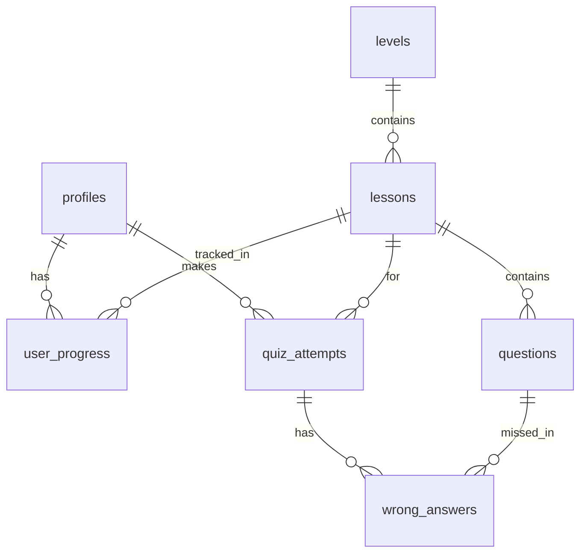

# CacheFlow

## Schema bazei de date



| Tabel         | Rol                                        |
| ------------- | ------------------------------------------ |
| profiles      | Datele utilizatorului, legat de auth.users |
| levels        | Nivelurile aplicației, în ordine           |
| lessons       | Lecțiile dintr-un nivel                    |
| questions     | Întrebările unei lecții                    |
| user_progress | Ce lecții a terminat fiecare utilizator    |
| quiz_attempts | Încercările de quiz și scorul              |
| wrong_answers | Răspunsurile greșite dintr-o încercare     |

Migrațiile se găsesc în `supabase/migrations`.
Aplicație educațională cu 4 niveluri (lecții video, chestionare, instrumente, examen final).

> Notă: viziunea completă, echipa și modul de lucru se află în PR #57. Acest README
> conține deocamdată doar partea tehnică agreată la tichetul **#1** (stack + structură).
> La merge-ul PR-ului #57, secțiunile se unesc.

## Stack (decizia #1)

| Strat     | Tehnologie                                | De ce                                                                                         |
| --------- | ----------------------------------------- | --------------------------------------------------------------------------------------------- |
| Framework | Next.js 16 (App Router)                   | Echipa a mai lucrat cu el; Server Components + Server Actions elimină un strat de API separat |
| Limbaj    | TypeScript (strict)                       | Tipuri partajate între server și client                                                       |
| UI / stil | Tailwind CSS v4                           | Stilizare rapidă, web responsive (desktop + telefon)                                          |
| Backend   | Supabase (PostgreSQL) + Auth              | Postgres găzduit + autentificare inclusă (se configurează la #44)                             |
| Runtime   | Node 24 LTS                               | Fixat în `.nvmrc` + `engines` + `engine-strict`                                               |
| Instalare | `npm ci` din `package-lock.json` (commis) | Versiuni identice la toți                                                                     |
| Deploy    | Vercel (ulterior)                         | Integrare nativă cu Next.js                                                                   |

Aplicație **web responsive**: rulează în browser pe laptop/PC, dar e gândită să arate
bine și pe telefon (conform Definition of Done). Verificarea testului pentru deblocarea
nivelului se va face **pe server** (Server Actions + Supabase), nu în frontend (#44).

## Pornire locală

Prerechizite: Node **24 LTS** (versiunea exactă în [`.nvmrc`](.nvmrc)).

```bash
nvm use            # sau: fnm use  (aliniază versiunea de Node)
npm ci             # instalează exact versiunile din package-lock.json
npm run dev        # pornește aplicația (merge și fără Supabase)
```

Aplicația pornește pe `http://localhost:3000`. Pentru variabilele de mediu (necesare
abia la #44): copiază `.env.example` în `.env.local`.

### Scripturi

| Script                 | Ce face                           |
| ---------------------- | --------------------------------- |
| `npm run dev`          | Server de dezvoltare (Next.js)    |
| `npm run build`        | Build de producție                |
| `npm run start`        | Rulează build-ul de producție     |
| `npm run typecheck`    | Verificare de tipuri (TypeScript) |
| `npm run lint`         | ESLint (reguli Next.js)           |
| `npm run format`       | Prettier (scrie modificările)     |
| `npm run format:check` | Prettier (doar verifică)          |

## Structura proiectului

```text
app/                # rute și pagini (App Router)
components/          # componente de UI reutilizabile (design comun — #3)
content/            # conținut: lecții + chestionare (format — #2)
backend/            # Server Actions (logica de server — backend, #44)
lib/                # client Supabase și utilitare (#44)
supabase/
  migrations/       # migrații SQL (schemă + RLS — #44)
```

Folderele goale sunt create de la început (criteriul de structură din #1) și se
populează la tichetele corespunzătoare. Convenție git: un branch per tichet
(`feature/<nr>-...`), PR cu `Closes #<nr>`, protecție pe `main`.

## Formatul conținutului (#2)

Conținutul fiecărui nivel stă într-un fișier `content/level-N.json` (N de la 1 la 4). Exemplu: `content/level-1.json`. Tipul TypeScript și funcția de validare sunt în `lib/content.ts`.

### Nivel

- `position`: numărul nivelului, de la 1 la 4;
- `title`: titlul nivelului;
- `description`: o scurtă descriere;
- `tool`: instrumentul nivelului, ex. `buget-personal`;
- `lessons`: lista lecțiilor;
- `questions`: lista întrebărilor.

### Lecție

- `position`: ordinea lecției în nivel, de la 1;
- `title`: titlul lecției;
- `video_url`: linkul video;
- `duration_sec`: durata în secunde;
- `description`: o scurtă descriere.

### Întrebare

- `id`: id stabil, ex. `L1-Q07`. Nu se schimbă după import, pentru că după el se actualizează întrebarea în baza de date;
- `text`: textul întrebării;
- `options`: lista variantelor de răspuns (minimum 2);
- `correct`: lista pozițiilor variantelor corecte, numerotate de la `0`;
- `explanation`: explicația răspunsului.

`correct` poate conține una sau mai multe poziții. De exemplu, `[0, 2]` înseamnă că prima și a treia variantă sunt corecte. Răspunsul este corect numai dacă variantele selectate coincid exact cu toate variantele corecte.

> `content/example.json` folosește formatul vechi (`lectii`, `intrebari`) și e încă citit de `/demo` și de ecranul de exersare. Rămâne până când aceste ecrane citesc întrebările din baza de date.

## Importul conținutului în Supabase (#47)

Scriptul `backend/seed.mjs` încarcă nivelurile, lecțiile și întrebările din `content/level-*.json` în baza de date.

1. În `.env.local` completează `NEXT_PUBLIC_SUPABASE_URL` și `SUPABASE_SERVICE_ROLE_KEY` (Supabase → Project Settings → API keys). Cheia `service_role` rămâne doar local și nu se comite.
2. Verifică că migrațiile din `supabase/migrations/` sunt aplicate pe baza de date.
3. Rulează:

```bash
npm run seed
```

Ce face scriptul:

- validează toate fișierele înainte de import; la eroare afișează fișierul și întrebarea problemă și nu importă nimic;
- actualizează după `position` (nivel), `level_id` + `position` (lecție) și `id` (întrebare, salvat în `external_id`), deci rularea repetată nu creează duplicate și preia textele modificate;
- avertizează dacă un nivel are sub 30 de întrebări;
- afișează la final câte lecții și întrebări are fiecare nivel.

Întrebările șterse dintr-un fișier JSON nu se șterg din baza de date.

## Design comun (#3)

Toate ecranele folosesc aceeași paletă, același font și componentele din `components/`.
Pagina `/demo` le arată pe toate, cu date din `content/example.json`.

### Fonturi

- **Geist** pentru tot textul aplicației (inclusiv diacriticele ă, â, î, ș, ț).
- **Geist Mono** doar pentru cifre sau cod, dacă e nevoie (`font-mono`).

Fonturile se încarcă prin `next/font/google` în `app/layout.tsx`, deci nu depind de
fonturile instalate pe telefon.

### Paleta de culori

Culorile sunt definite o singură dată în `app/globals.css` și se folosesc ca clase Tailwind
(ex. `bg-primary`, `text-correct`, `bg-wrong-soft`). Nu se scriu culori hex direct în componente.

| Rol                   | Clasă Tailwind                           | Luminos               | Întunecat             |
| --------------------- | ---------------------------------------- | --------------------- | --------------------- |
| Fundal pagină / text  | `bg-background` / `text-foreground`      | `#ffffff` / `#171717` | `#0a0a0a` / `#ededed` |
| Fundal card / margine | `bg-surface` / `border-border`           | `#ffffff` / `#e5e5e5` | `#171717` / `#2e2e2e` |
| Text secundar         | `text-muted`                             | `#525252`             | `#a3a3a3`             |
| Acțiune principală    | `bg-primary` + `text-primary-foreground` | `#1d4ed8`             | `#60a5fa`             |
| Disponibil (fundal)   | `bg-primary-soft`                        | `#dbeafe`             | `#172554`             |
| Corect / trecut       | `text-correct` / `bg-correct-soft`       | `#15803d` / `#dcfce7` | `#4ade80` / `#052e16` |
| Greșit                | `text-wrong` / `bg-wrong-soft`           | `#b91c1c` / `#fee2e2` | `#f87171` / `#450a0a` |
| Blocat                | `text-locked` / `bg-locked-soft`         | `#525252` / `#f5f5f5` | `#a3a3a3` / `#262626` |

Modul întunecat se aplică automat după setarea telefonului. Toate perechile text/fundal au
contrast de minimum 4.5:1 (WCAG AA).

### Componente

| Componentă       | Fișier                          | La ce folosește                                         |
| ---------------- | ------------------------------- | ------------------------------------------------------- |
| `Button`         | `components/Button.tsx`         | Butoane; variantele `primary` și `secondary`            |
| `Card`           | `components/Card.tsx`           | Container cu margine pentru conținut                    |
| `ProgressBar`    | `components/ProgressBar.tsx`    | Progres 0–100, accesibil (`role="progressbar"`)         |
| `StatusBadge`    | `components/StatusBadge.tsx`    | Starea unui nivel: blocat / disponibil / trecut         |
| `AnswerFeedback` | `components/AnswerFeedback.tsx` | Mesajul „Corect!” / „Greșit!” cu explicația răspunsului |

Ecranele sunt gândite mobile first și se verifică de la 360 px lățime în sus.
