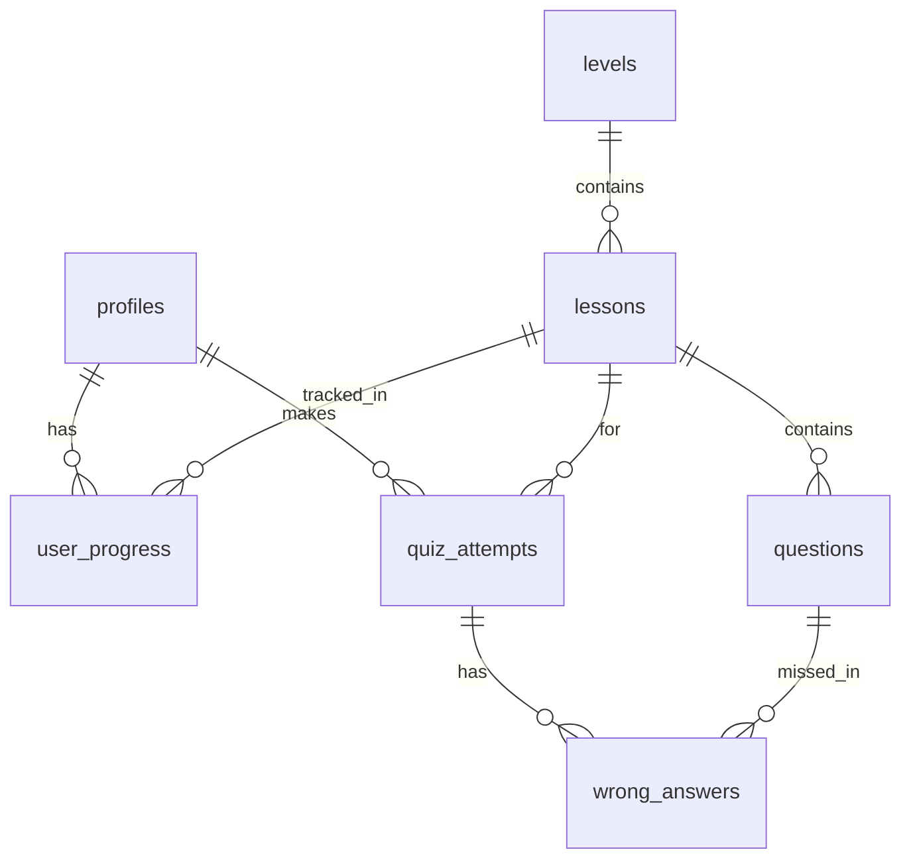

# CacheFlow

> Aplicație de educație financiară gamificată pentru tineri: înveți să-ți gestionezi banii prin lecții video, chestionare și simulări, nu prin teorie.

## Viziune

CacheFlow îi învață pe tinerii de 16–25 de ani, mai ales pe cei care părăsesc sistemul de protecție a copilului (centrele de plasament), conceptele financiare de bază: cum îți faci un buget, ce înseamnă o chirie, cum îți plătești facturile, cum economisești și cum te ferești de înșelătorii.

Lipsa educației financiare la vârsta majoratului îi poate duce pe tinerii vulnerabili direct în datorii. CacheFlow vrea să fie un „simulator de viață reală”, în care greșelile se fac în aplicație, nu în viața reală.

## Cum funcționează

Aplicația are trei secțiuni, ca o aplicație de chestionare auto, plus un instrument pentru viața reală:

```
            ┌──────────────┐     ┌──────────────┐
Acasă ───►  │ 1. STUDIU    │ ──► │ 2. EXAMEN    │
   │        │ învață       │     │ verifică     │
   │        └──────────────┘     └──────────────┘
   └──────► 3. BUGETUL MEU (oricând)
```

### 1. Studiu

Patru niveluri, parcurse în ordine:

```
Bugetul personal → Economii și urgențe → Taxe și salariu → Investiții și dobândă
```

Fiecare nivel are:

1. **Lecții video scurte** (2–5 minute)
2. **Chestionar de exersare**: grilă cu unul sau mai multe răspunsuri corecte, cu explicație imediată după fiecare răspuns. Fără prag, aici greșelile sunt binevenite.
3. **Un instrument interactiv**:

   | Nivel | Instrument |
   |---|---|
   | 1. Bugetul personal | Simulatorul de buget lunar: venit, chirie, facturi, mâncare, cheltuieli neprevăzute |
   | 2. Economii și urgențe | Jocul de decizii („chirie singur sau cu colegi?”), cu raport final despre consecințe |
   | 3. Taxe și salariu | Calculatorul „câte ore de muncă costă” un obiect |
   | 4. Investiții și dobândă | Vizualizatorul de dobândă compusă (18 vs. 30 de ani) și simulatorul de inflație |

Un nivel e **studiat** după ce ai văzut lecțiile și ai terminat exersarea. Atunci se deschide nivelul următor din Studiu și testul acelui nivel din Examen.

### 2. Examen

| Ce | Reguli | Prag |
|---|---|---|
| **Test de nivel** (câte unul pentru fiecare nivel studiat) | 10 întrebări aleatorii, fără limită de timp, explicațiile la final | **90%**: minimum 9/10 |
| **Examen final** (după ce treci toate cele 4 teste) | 20 de întrebări (5 din fiecare nivel), 25 de minute, se oprește la a 3-a greșeală | **90%**: minimum 18/20 |

Dacă pici, reiei cu alte întrebări din bancă. Întrebările greșite ajung în lista **„Întrebările mele greșite”**, pe care o poți relua oricând. La final primești un raport și un certificat.

### 3. Bugetul meu

Un instrument pentru banii reali ai utilizatorului, separat de simulatorul din Nivelul 1:

- introduci venitul lunar și îl **împarți pe categorii** (chirie, utilități, mâncare, transport, economii, timp liber etc.)
- primești o **împărțire sugerată** (de exemplu regula 50/30/20: nevoi / dorințe / economii), pe care o poți ajusta
- vezi împărțirea într-un grafic și cât a rămas nealocat
- notezi cheltuielile pe parcursul lunii și vezi cât mai ai pe fiecare categorie

### În afara MVP-ului (mai târziu)

- Comparatorul de credite
- Secțiunea despre fraude online, credite cu dobânzi ascunse și contracte de muncă

## Echipa

| Rol | Membri | Ce face |
|---|---|---|
| Product Owner | Nițan Ioana | ce se construiește și în ce ordine, conținutul |
| Scrum Master | Perșa Diana-Alexandra | ritmul echipei, board-ul, deblocarea problemelor; ajută la backend |
| Frontend | Putanu Elena-Florina, Vălcan Georgiana-Ana | ecranele, design-ul comun, instrumentele interactive |
| Backend | Leaț Elena Anabela, Stoina Alexia Fanuria | logica de server (Server Actions): chestionare, teste, progres, buget |
| Database | Popa Miruna Andreea, Nodiș Bianca-Loredana | Supabase: schema, migrațiile, Row Level Security, autentificarea, stocarea |
| Tester / QA | Mranovatz Brigitte | cazuri de test, verificarea fiecărui task, verificarea întrebărilor |

O funcționalitate trece de obicei prin toate cele trei echipe: database pregătește tabelele, backend scrie logica, frontend face ecranul. Cine lucrează efectiv la un task se vede la **Assignees** pe issue.

## Stack (decizia #1)

| Strat     | Tehnologie                                | De ce                                                                                         |
| --------- | ----------------------------------------- | --------------------------------------------------------------------------------------------- |
| Framework | Next.js 16 (App Router)                   | Echipa a mai lucrat cu el; Server Components + Server Actions elimină un strat de API separat |
| Limbaj    | TypeScript (strict)                       | Tipuri partajate între server și client                                                       |
| UI / stil | Tailwind CSS v4                           | Stilizare rapidă, web responsive (desktop + telefon)                                          |
| Backend   | Supabase (PostgreSQL) + Auth              | Postgres găzduit + autentificare inclusă (se configurează la #44)                             |
| Runtime   | Node 24 LTS                               | Fixat în `.nvmrc` + `engines` + `engine-strict`                                               |
| Instalare | `npm ci` din `package-lock.json` (commis) | Versiuni identice la toți                                                                     |
| Deploy    | Vercel (ulterior)                         | Integrare nativă cu Next.js                                                                   |

Aplicație **web responsive**: rulează în browser pe laptop/PC, dar e gândită să arate
bine și pe telefon (conform Definition of Done). Verificarea testului pentru deblocarea
nivelului se va face **pe server** (Server Actions + Supabase), nu în frontend (#44).

## Pornire locală

Prerechizite: Node **24 LTS** (versiunea exactă în [`.nvmrc`](.nvmrc)).

```bash
nvm use            # sau: fnm use  (aliniază versiunea de Node)
npm ci             # instalează exact versiunile din package-lock.json
npm run dev        # pornește aplicația (merge și fără Supabase)
```

Aplicația pornește pe `http://localhost:3000`. Pentru variabilele de mediu (necesare
abia la #44): copiază `.env.example` în `.env.local`.

| Variabilă | Descriere |
|---|---|
| `NEXT_PUBLIC_SUPABASE_URL` | URL-ul proiectului Supabase |
| `NEXT_PUBLIC_SUPABASE_ANON_KEY` | Cheia publică `anon` |

> ⚠️ Repo-ul e **public**. `.env.local` nu se pune niciodată pe GitHub, iar cheia `service_role` nu se folosește niciodată în cod de client.

### Scripturi

| Script                 | Ce face                           |
| ---------------------- | --------------------------------- |
| `npm run dev`          | Server de dezvoltare (Next.js)    |
| `npm run build`        | Build de producție                |
| `npm run start`        | Rulează build-ul de producție     |
| `npm run typecheck`    | Verificare de tipuri (TypeScript) |
| `npm run lint`         | ESLint (reguli Next.js)           |
| `npm run format`       | Prettier (scrie modificările)     |
| `npm run format:check` | Prettier (doar verifică)          |

## Structura proiectului

```text
app/                # rute și pagini (App Router)
components/          # componente de UI reutilizabile (design comun — #3)
content/            # conținut: lecții + chestionare (format — #2)
backend/            # Server Actions (logica de server — backend, #44)
lib/                # client Supabase și utilitare (#44)
supabase/
  migrations/       # migrații SQL (schemă + RLS — #44)
```

Folderele goale sunt create de la început (criteriul de structură din #1) și se
populează la tichetele corespunzătoare.

## Schema bazei de date



| Tabel         | Rol                                        |
| ------------- | ------------------------------------------ |
| profiles      | Datele utilizatorului, legat de auth.users |
| levels        | Nivelurile aplicației, în ordine           |
| lessons       | Lecțiile dintr-un nivel                    |
| questions     | Întrebările unei lecții                    |
| user_progress | Ce lecții a terminat fiecare utilizator    |
| quiz_attempts | Încercările de quiz și scorul              |
| wrong_answers | Răspunsurile greșite dintr-o încercare     |

Migrațiile se găsesc în `supabase/migrations`.

## Formatul conținutului

Exemplele de lecții și întrebări sunt în `content/example.json`. Fișierele de conținut folosesc JSON, cu două liste: `lectii` și `intrebari`.

### Lecții

Fiecare lecție conține:

- `nivel`: numărul nivelului, de la 1 la 4;
- `titlu`: titlul lecției;
- `link_video`: linkul video al lecției;
- `descriere`: o scurtă descriere a lecției.

### Întrebări

Fiecare întrebare conține:

- `nivel`: numărul nivelului, de la 1 la 4;
- `intrebare`: textul întrebării;
- `variante`: lista variantelor de răspuns;
- `corecte`: lista pozițiilor variantelor corecte, numerotate de la `0`;
- `explicatie`: explicația răspunsului.

`corecte` poate conține una sau mai multe poziții. De exemplu, `[0, 2]` înseamnă că prima și a treia variantă sunt corecte. Răspunsul este corect numai dacă variantele selectate coincid exact cu toate variantele corecte.

Cu pragul de 90%, fiecare nivel are nevoie de **cel puțin 30 de întrebări** în bancă, ca testele repetate să primească întrebări diferite. Fiecare întrebare e verificată de tester și aprobată de Product Owner înainte să intre în aplicație.

## Design comun (#3)

Toate ecranele folosesc aceeași paletă, același font și componentele din `components/`.
Pagina `/demo` le arată pe toate, cu date din `content/example.json`.

### Fonturi

- **Geist** pentru tot textul aplicației (inclusiv diacriticele ă, â, î, ș, ț).
- **Geist Mono** doar pentru cifre sau cod, dacă e nevoie (`font-mono`).

Fonturile se încarcă prin `next/font/google` în `app/layout.tsx`, deci nu depind de
fonturile instalate pe telefon.

### Paleta de culori

Culorile sunt definite o singură dată în `app/globals.css` și se folosesc ca clase Tailwind
(ex. `bg-primary`, `text-correct`, `bg-wrong-soft`). Nu se scriu culori hex direct în componente.

| Rol                   | Clasă Tailwind                           | Luminos               | Întunecat             |
| --------------------- | ---------------------------------------- | --------------------- | --------------------- |
| Fundal pagină / text  | `bg-background` / `text-foreground`      | `#ffffff` / `#171717` | `#0a0a0a` / `#ededed` |
| Fundal card / margine | `bg-surface` / `border-border`           | `#ffffff` / `#e5e5e5` | `#171717` / `#2e2e2e` |
| Text secundar         | `text-muted`                             | `#525252`             | `#a3a3a3`             |
| Acțiune principală    | `bg-primary` + `text-primary-foreground` | `#1d4ed8`             | `#60a5fa`             |
| Disponibil (fundal)   | `bg-primary-soft`                        | `#dbeafe`             | `#172554`             |
| Corect / trecut       | `text-correct` / `bg-correct-soft`       | `#15803d` / `#dcfce7` | `#4ade80` / `#052e16` |
| Greșit                | `text-wrong` / `bg-wrong-soft`           | `#b91c1c` / `#fee2e2` | `#f87171` / `#450a0a` |
| Blocat                | `text-locked` / `bg-locked-soft`         | `#525252` / `#f5f5f5` | `#a3a3a3` / `#262626` |

Modul întunecat se aplică automat după setarea telefonului. Toate perechile text/fundal au
contrast de minimum 4.5:1 (WCAG AA).

### Componente

| Componentă       | Fișier                          | La ce folosește                                         |
| ---------------- | ------------------------------- | ------------------------------------------------------- |
| `Button`         | `components/Button.tsx`         | Butoane; variantele `primary` și `secondary`            |
| `Card`           | `components/Card.tsx`           | Container cu margine pentru conținut                    |
| `ProgressBar`    | `components/ProgressBar.tsx`    | Progres 0–100, accesibil (`role="progressbar"`)         |
| `StatusBadge`    | `components/StatusBadge.tsx`    | Starea unui nivel: blocat / disponibil / trecut         |
| `AnswerFeedback` | `components/AnswerFeedback.tsx` | Mesajul „Corect!” / „Greșit!” cu explicația răspunsului |

Ecranele sunt gândite mobile first și se verifică de la 360 px lățime în sus.

## Cum lucrăm

Regulile complete (board, Definition of Done, Git, daily, retrospectivă, calendarul sprintului) sunt în [CONTRIBUTING.md](CONTRIBUTING.md). Pe scurt:

- Taskurile sunt pe [board-ul Kanban](https://github.com/orgs/CacheFlow-Project/projects/1)
- Un branch pentru fiecare issue (`feature/<nr>-...`), pull request cu `Closes #<nr>`
- `main` e protejat: merge doar cu cel puțin un review aprobat, fără push direct
- Un task e gata doar după ce l-a testat Brigitte

**Etichete utile:** `frontend`, `backend`, `database`, `rol: Product Owner`, `rol: Scrum Master`, `rol: tester`, `conținut`, `bugetul meu`, `must` / `should` / `could`

## Linkuri

- [Board Kanban](https://github.com/orgs/CacheFlow-Project/projects/1)
- [Issues](https://github.com/CacheFlow-Project/CacheFlow/issues)
- [Milestones](https://github.com/CacheFlow-Project/CacheFlow/milestones)
