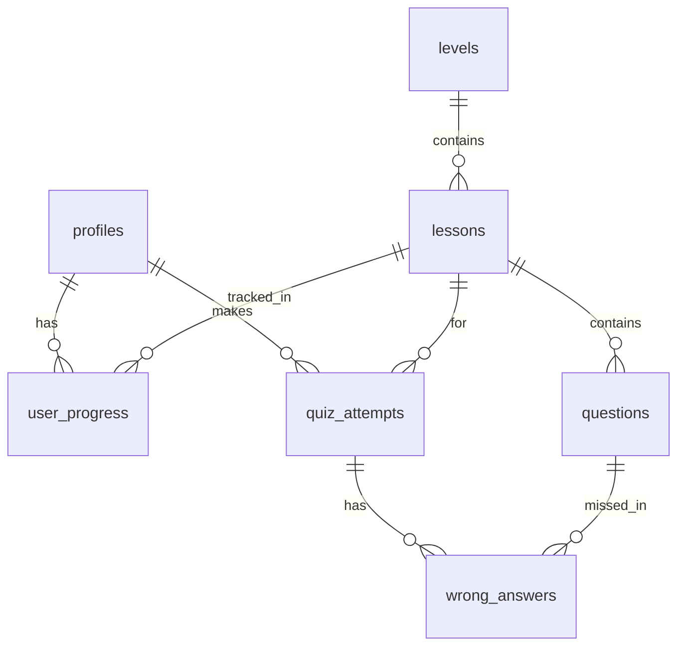

# CacheFlow

## Schema bazei de date

| Tabel | Rol |
|---|---|
| profiles | Datele utilizatorului, legat de auth.users |
| levels | Nivelurile aplicației, în ordine |
| lessons | Lecțiile dintr-un nivel |
| questions | Întrebările unei lecții |
| user_progress | Ce lecții a terminat fiecare utilizator |
| quiz_attempts | Încercările de quiz și scorul |
| wrong_answers | Răspunsurile greșite dintr-o încercare |

Migrațiile se găsesc în `supabase/migrations`.
